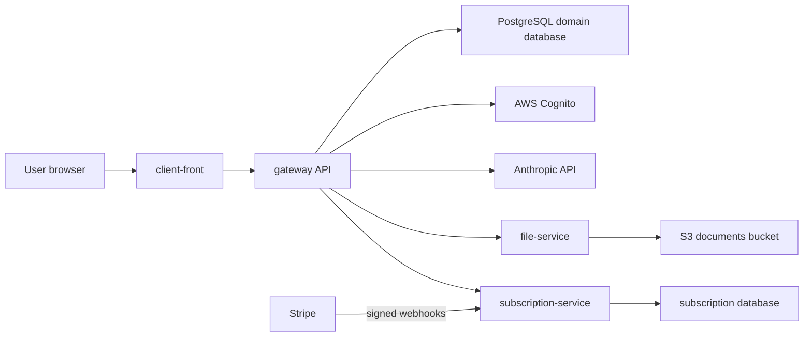

# Lexai Architecture Context

## Product Shape

Lexai handles legal matters, files, generated documents, teams, and paid AI usage. The architecture separates the public API and ownership checks from storage and billing integrations.

| Area | Current technology | Owns |
| --- | --- | --- |
| Web app | React 19, TypeScript, Vite, Bun, Tailwind CSS 4, TanStack Query, Zustand | UI composition and client interaction |
| Gateway | Java 21, Spring Boot 3.5, WebFlux, R2DBC, PostgreSQL, Cognito, Anthropic client | Authentication, domain API, document generation, internal service orchestration |
| Files | NestJS 11, TypeScript, AWS SDK v3, S3/LocalStack | File upload, streaming, deletion, and moves |
| Billing | NestJS 11, TypeScript, TypeORM, PostgreSQL, Stripe | Checkout, subscriptions, token ledger, webhook projection |
| Infrastructure | Terraform, AWS ECS Fargate, ALB, CloudFront/S3, RDS, Cognito, Secrets Manager, optional OpenSearch | Runtime topology and security controls |

## Runtime Flow

`infra/envs/dev` currently contains the fullest deployed service wiring, including internal service discovery from `gateway` to file and subscription services. Confirm parity in other environments before assuming it exists.

## Contract Ownership

- Public HTTP contracts are surfaced through `gateway`; coordinate frontend types and query invalidation when they change.
- File upload/download/move integration is a `gateway` to `file-service` internal contract. Storage keys represent private data and must not be accepted as authorization.
- Subscription checks, checkout, token reserve/commit/refund, and webhook-derived billing state are billing contracts. Use durable identifiers and idempotent processing.
- Environment variable names and secret mappings are contracts between applications and `infra`.
- Database changes belong to the owning service. Never infer that two services may mutate one another's tables merely because they share an RDS deployment.

## Navigation

Open the local `AGENTS.md` before implementing:

- UI, routes, queries, and design system: `client-front/AGENTS.md`
- Domain API, authentication, document or AI behavior: `gateway/AGENTS.md`
- Object storage behavior: `file-service/AGENTS.md`
- Payments, subscriptions, token accounting, Stripe: `subscription-service/AGENTS.md`
- AWS, Terraform, runtime networking, secret injection: `infra/AGENTS.md`
